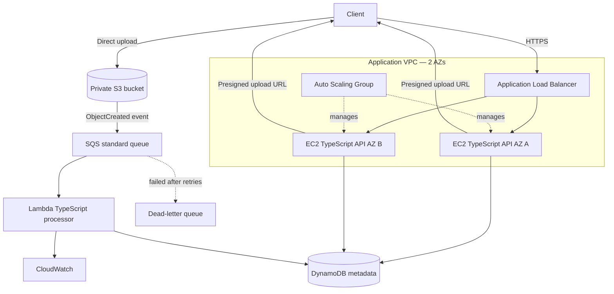

# Architecture — proposed, not deployed

## Network boundary

The ALB spans public subnets in two AZs; EC2 API instances span private subnets. S3, SQS and DynamoDB are AWS-managed regional services, not deployed inside the application subnets. Appropriate VPC endpoints or controlled outbound connectivity are required for private EC2 access to managed services.

## Flow

1. Client authenticates and requests a document-upload initiation.
2. API validates metadata and authorization, writes a PENDING_UPLOAD record, and creates a short-lived, scoped presigned S3 URL.
3. Client uploads directly to S3.
4. ObjectCreated notification enters SQS standard queue.
5. Lambda processes event and conditionally updates DynamoDB state.
6. Client polls an authenticated status endpoint.

## Open questions before implementation

- Authentication: Cognito or external OIDC provider; decide based on cost and user requirements.
- Allowed file types and maximum sizes.
- Malware inspection requirements.
- Request rate limits and API performance workload.
- Event ordering and safe replay strategy for repeated object keys.
- NAT per AZ versus cost-reduced lab networking.
- Single-region recovery strategy.
